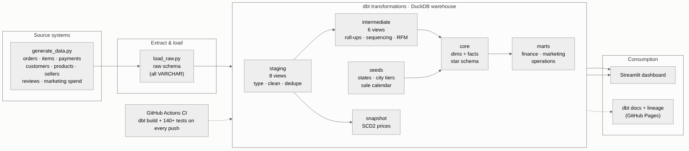
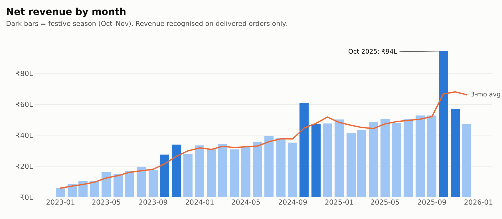
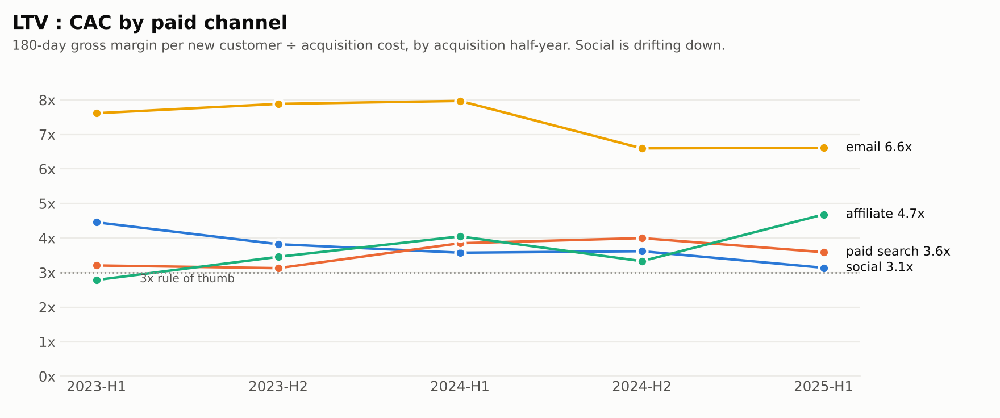
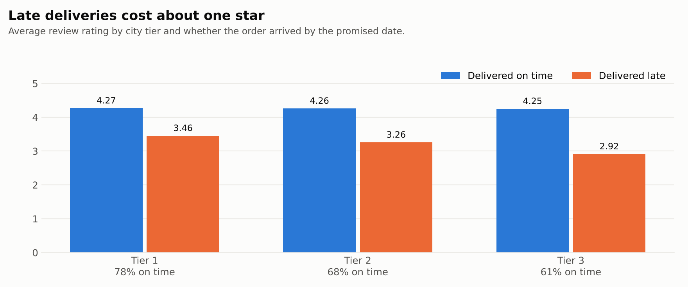
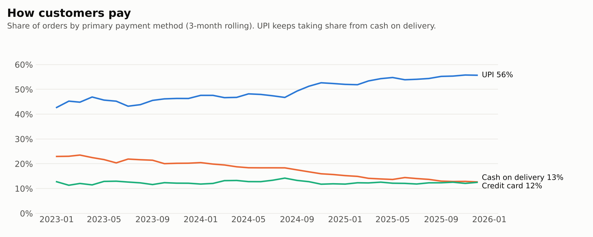
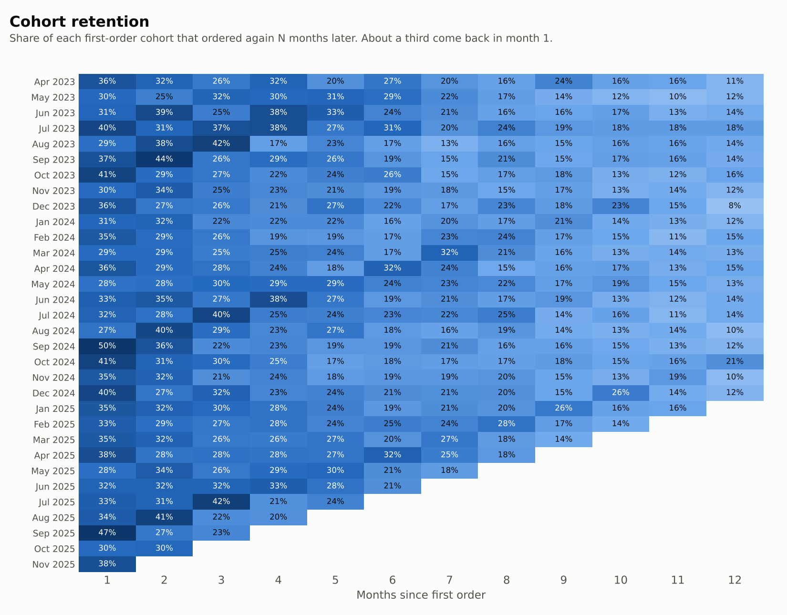
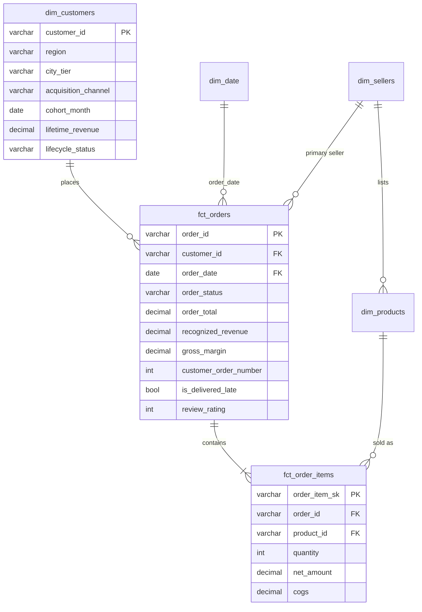

# ShopFlow Analytics: an end-to-end modern data stack with dbt and DuckDB

[](https://github.com/Dharmeshkumar2327/shopflow-analytics/actions/workflows/ci.yml)


## 🚀 Live Project

<p align="center">
  <a href="https://shopflow-analytics-nh2a9ucu75xyequqmv94cc.streamlit.app/">
    
  </a>
</p>

🌐 **Live Dashboard:** [Explore ShopFlow Analytics](https://shopflow-analytics-nh2a9ucu75xyequqmv94cc.streamlit.app/)

💻 **GitHub Repository:** [View Source Code](https://github.com/Dharmeshkumar2327/shopflow-analytics)

Explore interactive business insights, revenue trends, customer segmentation, marketing performance, sales analytics, and operational performance through the live ShopFlow Analytics dashboard.


An analytics engineering project for **ShopFlow**, a fictional Indian e-commerce marketplace.
Raw, messy operational data goes in. Tested, documented, business-ready data marts come out, and a
dashboard and the analyses that leadership actually asks for are built on top of them.

> Runs fully on a laptop in about 2 minutes, with no cloud account or credentials needed. One command builds everything.



---

## Business questions this project answers

| Stakeholder | Question | Answered by |
|---|---|---|
| CFO | How is revenue trending like-for-like, and what is our margin by category? | `fin_monthly_kpis`, `fin_category_performance` |
| CFO | Are festive sales profitable growth, or are we just paying for demand we'd get anyway? | `analyses/festive_season_uplift.sql` |
| CMO | Which acquisition channels pay back? Is any channel getting more expensive? | `mkt_channel_performance` (CAC, 180-day LTV, LTV:CAC) |
| CRM lead | Who are our best customers, and who are we about to lose? | `mkt_rfm_segments` (8 segments with recommended actions) |
| Growth | Do customers come back after their first order? | `mkt_customer_cohorts` (retention and LTV curves) |
| Ops head | Where do we miss delivery promises, and what does that cost us in ratings? | `ops_delivery_performance` |
| Category / seller team | Which sellers should we promote and which need fixing? | `ops_seller_scorecard` (weighted score and tiers) |
| Payments | How fast is UPI replacing cash on delivery? | `fin_payment_method_mix` |

---

## Key findings

*From the generated dataset (10,000 customers, about 41k orders, Jan 2023 – Dec 2025, seed 42). The data is
synthetic, so these results show the analysis method rather than a real company's results.*

**1. Revenue is up 37% like-for-like.** Apr–Dec 2025 net revenue was ₹5.01 Cr, against ₹3.67 Cr for the
same months of 2024. Gross margin held steady at about 25%.



**2. Festive sales roughly double daily orders. Shorter national sales mostly give the margin away.**
Each sale is compared with the 28 days before it, not with an all-time average, because growth would
distort that comparison. Festive seasons lift daily orders by 94–124% at a 15% discount rate (versus about 1.5% normally).
Republic Day and Independence Day sales in 2024–25 lifted *orders* by 33–42%, but *demand value* by only 7–27%.
The discount gives away most of the uplift.

**3. Social media is losing efficiency, and affiliate is gaining.** 180-day LTV:CAC for social fell from
4.4x (2023-H1) to 3.1x (2025-H1), close to the 3x floor. Affiliate climbed to 4.7x. The suggested action is to move
incremental budget from social to affiliate and paid search, and to re-test social creatives.



**4. 41% of customers bring in 62% of revenue.** Champions and Loyal customers (3,438 people) generate 62% of
lifetime revenue. The **Cannot Lose Them** segment (704 formerly high-value customers who have gone quiet)
holds ₹2.6 Cr of historical revenue and is the top win-back priority.

**5. A late delivery costs about one star.** On-time orders average 4.3★ in every tier. Late orders drop
to 3.5★ (Tier 1) and 2.9★ (Tier 3), and Tier 3 cities are on time only 61% of the time (versus 78% in Tier 1).
Fixing Tier 3 logistics is a customer-experience lever, not just a cost question.



**6. UPI keeps replacing cash on delivery.** UPI's share of orders rose from 43% to 56%, while COD fell from
23% to 13%. That means fewer failed COD deliveries and faster cash collection.



<details>
<summary><b>Cohort retention heat-map</b></summary>



</details>

---

## What this project demonstrates

| Practice | How it is implemented |
|---|---|
| **Layered modelling** | `raw` → `staging` (8 views: type, clean, dedupe) → `intermediate` (6 views) → `core` star schema → `finance` / `marketing` / `operations` marts. 28 models in total |
| **Dimensional modelling** | `fct_orders`, `fct_order_items`, `dim_customers`, `dim_products`, `dim_sellers`, `dim_date` (with the Indian fiscal year and sale calendar) |
| **Data quality** | 140+ automated checks: `unique`, `not_null`, `relationships` and `accepted_values`, plus 4 custom generic tests (`is_non_negative`, `value_between`, `not_before`, `unique_combination`) and 4 singular **finance reconciliation** tests (payments tie to order totals, KPI table ties to the fact table to the rupee) |
| **Unit tests** (dbt 1.8+) | Mocked inputs test the order-sequencing logic and every RFM segmentation rule |
| **Messy-data handling** | CDC duplicate customers (dedupe with `qualify`), 15+ spellings of payment methods, inconsistent casing and whitespace, raw text conformed to reference seeds |
| **Incremental processing** | `fct_order_items` uses `delete+insert` with a 3-day look-back window for late-arriving status changes |
| **Slowly changing dimensions** | `snap_products` keeps SCD Type 2 price history with a dbt snapshot |
| **Reusable macros** | Indian fiscal year and quarter, `safe_divide`, `surrogate_key`, label normalisation, and a custom `generate_schema_name` |
| **Single source of metric truth** | Every KPI is defined once ([docs/metrics.md](docs/metrics.md)), and the dashboard reads only from marts |
| **Documentation and lineage** | Column descriptions, doc blocks, and an `exposure` linking the dashboard to its upstream models. `dbt docs` is published to GitHub Pages |
| **CI/CD** | GitHub Actions on every push and PR: generate → load → `dbt build` (all tests) → dashboard query smoke test → publish docs |
| **Reproducibility** | Deterministic seeded data generator, pinned dependencies, and one-command pipeline |

---

## Quick start

**Requirements:** Python 3.11 or 3.12 and Git.

```bash
git clone https://github.com/Dharmeshkumar2327/shopflow-analytics.git
cd shopflow-analytics

python -m venv .venv
# Windows:        .venv\Scripts\activate
# macOS / Linux:  source .venv/bin/activate

pip install -r requirements.txt

python pipeline.py --dashboard     # generate data -> load -> dbt build -> docs -> open dashboard
```

The dashboard opens at <http://localhost:8501>. To explore the lineage graph and column documentation:

```bash
cd transform
dbt docs serve --profiles-dir .    # http://localhost:8080
```

<details>
<summary>Step by step (or with <code>make</code> on macOS/Linux)</summary>

```bash
python scripts/generate_data.py          # 1. raw CSVs -> data/raw/        (make data)
python scripts/load_raw.py               # 2. CSVs -> DuckDB raw schema     (make load)
cd transform
dbt build --profiles-dir .               # 3. seeds, models, snapshot, tests (make build)
dbt test  --profiles-dir . --select test_type:unit    # unit tests only
dbt build --profiles-dir . --select +fin_monthly_kpis # one mart and its upstream
cd ..
streamlit run dashboard/app.py           # 4. dashboard                     (make dashboard)
```
</details>

---

## Data model



| Layer | Models |
|---|---|
| **staging** | `stg_shopflow__customers`, `__orders`, `__order_items`, `__payments`, `__products`, `__sellers`, `__reviews`, `__marketing_spend` |
| **intermediate** | `int_order_items__enriched`, `int_orders__items_rolled_up`, `int_payments__rolled_up`, `int_orders__sequenced`, `int_customers__order_history`, `int_customers__rfm_scores` |
| **core** | `fct_orders`, `fct_order_items` (incremental), `dim_customers`, `dim_products`, `dim_sellers`, `dim_date` |
| **finance** | `fin_monthly_kpis`, `fin_payment_method_mix`, `fin_category_performance` |
| **marketing** | `mkt_customer_cohorts`, `mkt_rfm_segments`, `mkt_channel_performance` |
| **operations** | `ops_delivery_performance`, `ops_seller_scorecard` |
| **seeds** | `ref_indian_states`, `ref_city_tiers`, `ref_sale_events` |
| **snapshots** | `snap_products` (SCD2) |
| **analyses** | `festive_season_uplift`, `retention_matrix` |

---

## Project structure

```
shopflow-analytics/
├── pipeline.py                  # one-command, cross-platform runner
├── scripts/
│   ├── generate_data.py         # seeded synthetic source data (with deliberate quality issues)
│   └── load_raw.py              # EL: CSV -> DuckDB raw schema (all VARCHAR)
├── transform/                   # the dbt project
│   ├── models/
│   │   ├── staging/shopflow/    # 1:1 with source tables
│   │   ├── intermediate/        # reusable building blocks
│   │   ├── marts/
│   │   │   ├── core/            # star schema
│   │   │   ├── finance/
│   │   │   ├── marketing/
│   │   │   └── operations/
│   │   ├── docs.md              # doc blocks
│   │   └── exposures.yml        # dashboard -> model lineage
│   ├── seeds/                   # reference data
│   ├── snapshots/               # SCD2
│   ├── macros/                  # fiscal calendar, utils, schema naming
│   ├── tests/                   # singular reconciliation tests + generic tests
│   └── analyses/                # ad-hoc SQL kept under version control
├── dashboard/
│   ├── app.py                   # Streamlit + Plotly
│   └── queries.py               # SQL, reads marts only
├── docs/
│   ├── metrics.md               # metric definitions
│   └── images/
└── .github/workflows/ci.yml     # CI + dbt docs on GitHub Pages
```

---

## Design decisions

- **DuckDB instead of a cloud warehouse.** Anyone can clone and run the project in minutes for free. The dbt code is
  warehouse-agnostic apart from a few DuckDB functions (`arg_max`, `qualify`, `date_diff`), each of which has a direct
  Snowflake or BigQuery equivalent. Moving warehouses means changing `profiles.yml`.
- **Raw data lands as VARCHAR.** The loader never guesses types. All casting and cleaning happen in staging,
  where they are visible, version-controlled and tested.
- **Revenue is recognised on delivery.** This stops GMV inflation from cancellations and returns. Both GMV and net revenue
  are kept so finance and marketing can each use their own view without arguing about the number.
- **The as-of date is a variable.** Recency, churn and LTV windows use `var('as_of_date')`, so results are reproducible
  and the logic can be back-tested at any point in time.
- **Intermediate models are views, marts are tables.** Building blocks stay cheap, and what the dashboard queries is fast.

## Roadmap

- [ ] MetricFlow semantic layer for governed metrics
- [ ] Orchestrate with Dagster or Airflow and add source freshness SLAs
- [ ] Data contracts (`contract: enforced`) on the core facts
- [ ] Deploy the same project to BigQuery or Snowflake through a second dbt target

---

**Author:** Dharmesh Kumar · [GitHub](https://github.com/Dharmeshkumar2327) · [LinkedIn](https://www.linkedin.com/in/dharmesh-kumar-293a89235)

Released under the MIT License.
